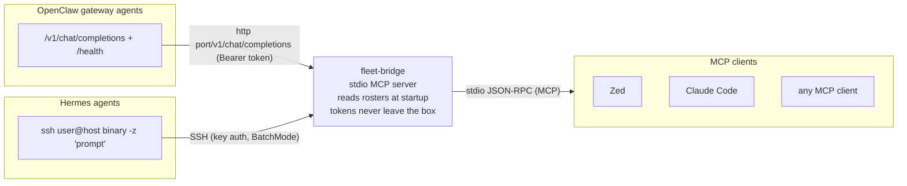

<!-- sources: index.ts, README.md, package.json -->

# fleet-bridge

fleet-bridge is a stdio MCP server (TypeScript, Node >= 18, version 0.1.1)
that exposes a single tool surface across two agent runtimes:

- **OpenClaw gateway agents**, reached over HTTP at
  `http://{host}:{port}/v1/chat/completions` with Bearer-token auth, plus
  `GET /health` for health checks.
- **Hermes agents**, reached over SSH by running the `hermes` CLI remotely in
  one-shot mode (`hermes -z '<prompt>'`).

Any MCP client — Claude Code, Zed, or anything else that speaks MCP over
stdio — sees one list of six tools and invokes any agent by name. The bridge
itself is stateless: conversation state for multi-turn sessions is persisted
server-side by the OpenClaw gateway, keyed by a `session_key` the bridge
generates. Rosters are read once at startup.

fleet-bridge is MIT licensed.

## How it works

1. At startup the bridge reads two roster files: `agents.json` (OpenClaw
   agents) and `hermes-agents.json` (Hermes agents). Paths are set by the
   `FLEET_BRIDGE_AGENTS` and `FLEET_BRIDGE_HERMES` environment variables.
2. OpenClaw invokes stream SSE-style `data:` lines from
   `/v1/chat/completions` and accumulate delta text into a single reply.
3. Hermes invokes spawn `ssh {ssh_user}@{host} {binary} -z '<prompt>'` and
   return the process stdout.
4. Every tool returns its result as a text content block. Errors return
   `isError: true` with a `fleet-bridge error: ...` message.

Security model: agent tokens and Hermes SSH details live only in the roster
files on the box running the bridge and are stripped from every tool output.
Agent traffic is plain `http://` by design — run the bridge on a network you
trust (loopback, LAN, or a private overlay). No TLS option in v0.1.

## Who it is for

Operators running a fleet of OpenClaw gateway agents and/or Hermes agents who
want to drive them from any MCP client without building per-runtime
integrations. One bridge instance covers the whole roster; adding an agent is
one JSON entry plus a restart.

## In this section

- [Getting started](./getting-started.md) — install, build, first run
- [Configuration](./configuration.md) — roster schemas and environment variables
- [Tools](./tools/index.md) — the six tools, per-tool reference
- [MCP clients](./clients/claude-code.md) — wiring into Claude Code, Zed, or any client
- [Troubleshooting](./troubleshooting.md) — timeouts, roster failures, token stripping
